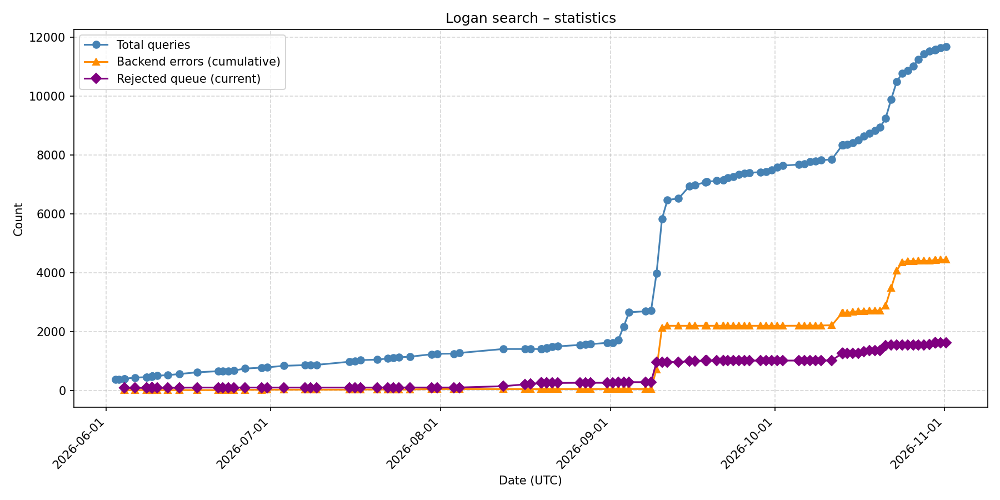
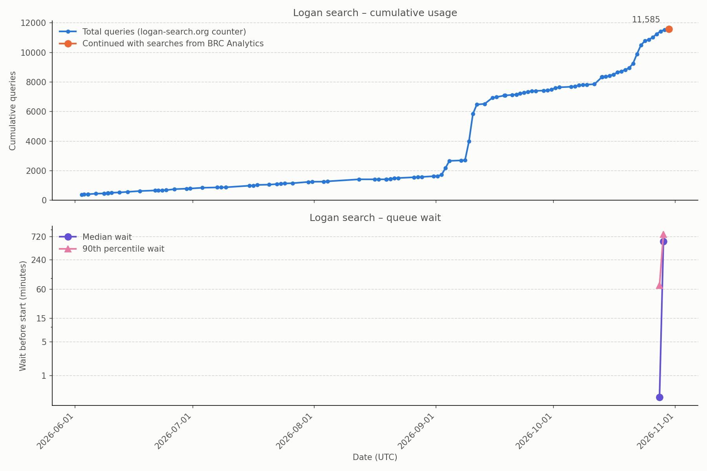

# Logan Search usage statistics

Usage statistics of [Logan Search](https://logan-search.org), updated once a day.

## Queries made on logan-search.org

Total queries, backend errors and rejected queue over time.

## Queries made on the backend

The top panel shows the logan-search.org counter up to 2026-10-30 (11,573 queries), then adds the backend queries
submitted after that date. Since the two sources do not count the same queries, the second part is not a strict
continuation of the first.

The bottom panel shows the daily median and 90th percentile of the wait before a query starts. Queries answered from
Galaxy's job cache are excluded, as they never queue.

## Data origin

The figures come from two services, which do not count the same queries:

| Source | What it counts | Provided by |
|---|---|---|
| https://logan-search.org/api/admin/stats | Queries made on logan-search.org, including failed queries and queries answered from the local cache | logan-search.org |
| https://dev.brc-analytics.org/api/v1/galaxy/kmindex/queue/history | Queries made on the backend, including queries made by other means, notably through https://logan.dev.brc-analytics.org/ | BRC Analytics, from Galaxy |

The first source can therefore count more queries than the second, because of failed and locally cached queries. The
second one also includes queries that were not made on logan-search.org.
